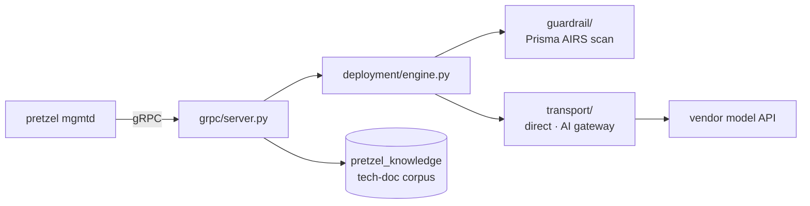

# pretzel-ai

The AI inference service for [pretzel](https://github.com/starga-ze/pretzel). A standalone Python
gRPC service that `mgmtd` calls, replacing the old in-tree `inferd` daemon.

A chat turn streams back token by token (`Chat` is a server-streaming RPC); the final chunk carries
the complete turn document — reply, AIRS scan verdict, usage — that mgmtd files verbatim. It also
owns the tech-doc corpus the assistant answers out of.

---

## Quick Start

Requires Ubuntu/Debian, Python 3.10+ and sudo. `install`, `start` and `stop` re-exec under `sudo`
automatically.

```bash
./pretzel-ai install     # venv + deps + generated gRPC stubs + /var/log/pretzel-ai
./pretzel-ai start       # run under systemd as pretzel-ai.service
```

It listens on `127.0.0.1:50051` and logs to a rotating file:

```bash
tail -f /var/log/pretzel-ai/pretzel-ai.log
```

| Command | What it does |
|---|---|
| `./pretzel-ai install` | Create `.venv`, install `requirements.txt`, generate stubs, prepare the log directory |
| `./pretzel-ai build` | Regenerate the gRPC stubs from `src/grpc/pretzel_ai.proto` |
| `./pretzel-ai start` / `stop` | Run the daemon under systemd / stop and disable it |
| `./pretzel-ai clean` | Remove generated stubs and caches |
| `./pretzel-ai package` | Build an offline installer tarball for a production host |

A fresh install comes up **listening and mute** — no models, so no turn can be served — and says so
in the log. That is the only state it can be in before the appliance has pushed a configuration,
which is why a deployment that cannot serve is not fatal at startup.

---

## Architecture



A deployment has two independent axes, and the code keeps them that way: **who serves the
completion** (`deployment/transport.py` — the vendor directly, or the AI gateway) and **who
inspects the turn** (`deployment/guardrail.py` — nothing, or the Prisma AIRS scan API). Neither
module reads the other's setting, so a guardrail can be added to a deployment without moving its
traffic, and a transport can be changed without changing who looks at it.

Two services sit on top. `chat` is one model call per turn — scan the prompt, call, scan the
response, answer — with no tools offered and so nothing to loop over. `agent`, a loop over tools,
is declared and refused rather than half-served.

Guardrail enforcement runs at four checkpoints: prompt, response, tool call, tool result. On the
direct transport nothing inspects a turn unless this service inspects it, and a completion there
carries no gateway hook results — their absence is not a clean scan.

---

## Configuration

There is **no config file.** Which vendors serve turns, which of their models may be asked for, the
guardrail, and how a turn is shaped are all committed in the appliance's console, versioned in its
running-config, and pushed here over `ApplyConfig`. This service reads no configuration database
and holds no file of record; it applies what it is told and caches the last document at
`/etc/pretzel-ai/deployment.json` (root, 0600) so a restart does not leave it mute until the next
push.

| Pushed | running-config | Notes |
|---|---|---|
| providers, models | `pretzel-ai.providers.list` | endpoints are compiled in here, not configured |
| guardrail kind, AIRS endpoint, profile, timeout, fail-open | `pretzel-ai.guardrail` | |
| the four checkpoints | `pretzel-ai.guardrail.inspect_*` | prompt · response · tool_call · tool_result |
| system prompt, token cap, timeout | `pretzel-ai.shape` | |
| vendor keys, the AIRS key | *not* in running-config | sealed in `ai_provider_credential_state`, unsealed by mgmtd for the push |

The model catalog is answered over the wire (`ListModels`) rather than committed to running-config:
what is reachable depends on the accounts behind the gateway or the keys on the box, and rolling a
configuration back does not put a model back in someone's account.

The guardrail used to live in this service's own `config.json` so that an appliance changing which
models it served could not change whether turns were inspected. The console owns it now; what
protects it is that every change is a committed, versioned running-config edit rendered in a review
diff.

### Environment

Every credential — vendor keys and the AIRS key alike — arrives over `ApplyConfig` and is taken
from the pushed document. There is no environment fallback for keys, so with nothing in front of
this service it serves no turns. The environment only locates things:

| Variable | Default | Read by |
|---|---|---|
| `PZ_PRETZEL_AI_STATE` | `/etc/pretzel-ai/deployment.json` | where the pushed document is cached |
| `PZ_PRETZEL_AI_LOG_LEVEL` | `info` | `src/main.py` |
| `PZ_KNOWLEDGE_DSN` | built from `PZ_PG_PASSWORD` | the corpus store (`src/crawler/store.py`) |

---

## Layout

```
pretzel-ai                       CLI dispatcher
script/                          install / build / start / stop / clean / package
requirements.txt                 pinned dependencies (see Dependencies)
src/main.py                      entry point: args and log level, then the daemon
src/process/                     the daemon's lifecycle (signals -> config -> services -> serve)
  core.py                        lifecycle owner and the gRPC server
  log.py                         rotating file log at /var/log/pretzel-ai
src/deployment/                  the pushed document, and what it builds
  config.py                      protobuf -> plain data
  service.py                     the services this daemon runs (chat, agent)
  engine.py                      catalog + transport + guardrail, held together
  catalog.py                     which models may be asked for
  transport.py                   who serves the completion
  guardrail.py                   who inspects the turn
src/transport/                   direct.py (straight to the vendor) · ai_gateway.py
src/guardrail/api_application.py the Prisma AIRS guardrail and its enforcement point
src/engine/                      chat.py (the turn) · console.py (TurnResult, as the console parses it)
src/completion/wire.py           the OpenAI chat-completions shape, encoded and decoded
src/grpc/                        everything gRPC
  pretzel_ai.proto               the mgmtd <-> pretzel-ai contract (source of truth,
                                 mirrored into pretzel/mgmtd/grpc/)
  server.py                      the servicer, composed from grpc/handlers/
  handlers/                      chat · config · corpus · benchmark · benchtest
src/crawler/                     the tech-doc crawler (sitemap -> fetch -> extract -> store)
src/benchmark/                   guardrail benchmark runs: caller, runner, scoring, store
sql/                             pretzel_knowledge migrations
dataset/                         benchmark prompt sets and scoring scripts
tests/                           corpus tests
docs/corpus-operations.md        corpus runbook
```

`src/grpc/` is a package inside `src` rather than a directory at the repo root: a top-level
`grpc/` would shadow grpcio's own module for anything that put the root on `sys.path`.

---

## Dependencies

`./pretzel-ai install` creates `.venv` and installs `requirements.txt` into it. Nothing is
installed system-wide except `python3-venv` and `python3-dev` via apt, if missing.

| Package | Version | Used for |
|---|---|---|
| `grpcio` | 1.62.1 | The gRPC server; pinned to the version the pretzel repo vendors for the C++ side so the protobuf runtime and wire format match on both ends |
| `grpcio-tools` | 1.62.1 | Stub generation (`./pretzel-ai build`) |
| `psycopg[binary]` | 3.2.3 | `pretzel_knowledge`; psycopg 3 for its binary wheel and for the pipeline/COPY support a 21k-page crawl needs |
| `portkey-ai` | 2.3.4 | The AI Gateway client, used by `src/transport/ai_gateway.py` |
| `pan-aisecurity` | 0.11.0 | The Prisma AIRS scan API — taken for its request **schema**, whose traps (nested `tool_event.metadata`, `input`/`output` as JSON strings) are already encoded in its generated models; the synchronous `scan.inline` client is what a gRPC worker thread needs |
| `beautifulsoup4` | 4.13.5 | DOM-based tech-document extraction |

Pins are deliberate; `requirements.txt` records what each version is load-bearing for.

---

## The tech-doc corpus

The assistant answers out of `pretzel_knowledge`, crawled from docs.paloaltonetworks.com. Two
schemas: `techdoc` (crawled, expensive to reacquire, back this up) and `corpus` (chunks and
embeddings, derived, rebuilt whenever the chunking rules or the model change).

```bash
python -m src.crawler check                  # what has moved since the last crawl
python -m src.crawler refresh --scope ngfw   # apply it
python -m src.crawler status                 # what the store holds
```

The console drives the same operations from **System Management ▸ Operation ▸ Tech
Documentation**. The CLI is for the first full build, which fetches every page and is a job to
leave running in a terminal.

---

## Status

Wire and gateway working. Not yet: browser-side token streaming (mgmtd currently files the whole
answer on a poll), and the DB-sealed credential path.

This is an experimental single-developer project, not a product. It is not affiliated with or
endorsed by Palo Alto Networks; product names appear only to describe what it integrates with.
